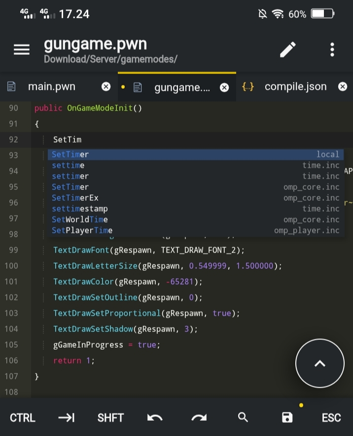
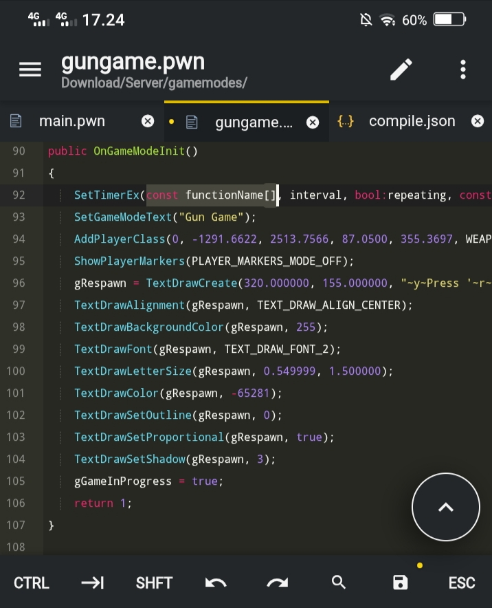
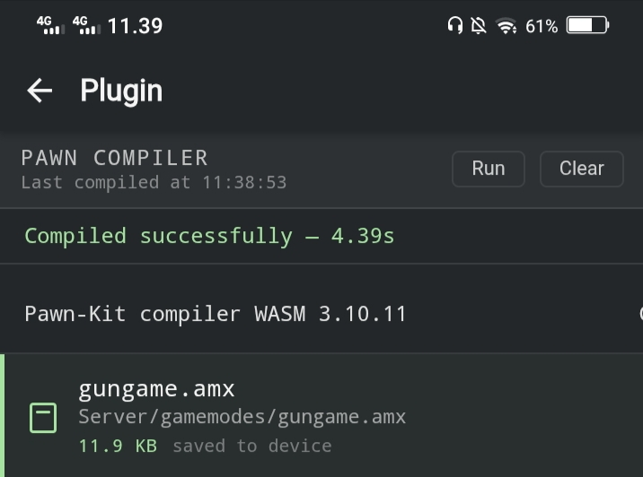

<div align="center">


# Pawn-Kit

**Pawn tools for [Acode Editor](https://acode.foxdebug.com/).**

[](LICENSE)
[](#)
[](https://acode.foxdebug.com/)
[](https://open.mp)

</div>

Pawn-Kit provides syntax highlighting, snippets, and autocompletion for **SA-MP / open.mp**
along with support for popular plugins, plus a built-in Pawn compiler — all in one Acode plugin for Android.

## CodeMirror 6 support (v1.0.7)

Pawn-Kit 1.0.7 is **CodeMirror-only**. Ace editor mode is no longer supported.
Pawn files (`.pwn` and `.inc`) are registered through Acode's `editorLanguages` API,
and use a CodeMirror 6 stream tokenizer rather than injecting editor configuration.
Autocomplete remains available with the existing 1,946 snippets. The optional pawncc WASM
compiler is retained.

**Status:** The migration has passed TypeScript and mocked editor/tokenizer tests, but
still requires an Android Acode integration test before publishing a stable release.

## Features

- Syntax highlighting for `.pwn` and `.inc` files
- 1900+ snippets from **SA-MP / open.mp** natives and popular plugins
- Autocomplete with optional function descriptions
- Built-in Pawn compiler (pawncc 3.10.11)

## Installation

Search for **Pawn-Kit** in Acode's plugin manager and install it.

**Tip**
> For the best syntax highlighting experience, it is recommended to use the **Monokai** theme,
> as the syntax color scheme is based on the Sublime Text Pawn Kit.

## Compiling Pawn Code

To compile your script, enable the compiler and press **Ctrl+Shift+B** while a `.pwn` file is open.

Compiler output and errors will appear in the compiler UI and will also be written to `.pawn/compile.log`.

> The compiler must be enabled first via **Settings → Plugin → Pawn-Kit → Settings → Enable Pawn Compiler**.

### Setting Up `compile.json`

Pawn-Kit reads a `.pawn/compile.json` file in the project root to configure the compiler.

Create the folder and file:

```
your-project/
└── .pawn/
    └── compile.json
````

Then paste the following into `compile.json`:

```json
{
  "version": "1.0",
  "tasks": [
    {
      "label": "build",
      "args": ["${file}", "-D${fileDirname}", "-;+", "-(+", "-d3"],
      "includes": ["${workspaceRoot}/qawno/include", "${workspaceRoot}/gamemodes/src"],
      "group": { "kind": "build", "isDefault": true }
    }
  ]
}
````

#### Explanation

`"args"` defines the flags passed to pawncc:

* `${file}` — the currently open `.pwn` file
* `-D${fileDirname}` — sets the output directory to the same folder as the source file
* `-;+` — enforce semicolons
* `-(+` — enforce brackets in statements
* `-d3` — enable full debug symbols (remove this if you don't use crashdetect)

`"includes"` is an array of include directories. Adjust these paths to match your project structure. Common paths:

* `${workspaceRoot}/qawno/include` — default SA-MP / open.mp include folder
* `${workspaceRoot}/gamemodes/src` — custom include folder

`${workspaceRoot}` resolves to your project's root directory.

### Screenshots

#### Syntax Highlight and Autocomplete





#### Built-in Compiler




## Settings

| Key              | Default | Description                                                                          |
| ---------------- | ------- | ------------------------------------------------------------------------------------ |
| `snippetDocs`    | `false` | Show brief docs about snippets in autocomplete                                       |
| `enableCompiler` | `false` | Enable Pawn compiler via Ctrl+Shift+B. Requires `.pawn/compile.json` in project root |

## Credits

* **pawn-openmp-sublime-kit** by [punkochel](https://github.com/punkochel)
* **Fanorisky** — project author

## License

MIT License — See the `LICENSE` file for details.